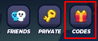
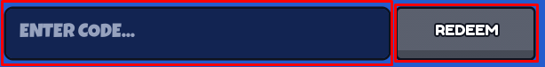

# Screenshots · [🌍 2D] Rule The Globe

[**Download the illustrated reference sheet (PDF)**](rule-the-globe-screenshots.pdf)

[Rule The Globe on Roblox](https://www.roblox.com/games/127135425701849/Rule-The-Globe) is the Starium Games experience (place `127135425701849`), also [listed under its 2D title](https://robipedia.com/game/2d-rule-the-globe-10769225661). These are external references, not pictures of Conquer. They are **not** installed with or requested by the offline game.

## In-game screenshots

[Roblox Den’s Rule The Globe guide](https://robloxden.com/game-codes/rule-the-globe) publishes these two **cropped interface screenshots**. The red outlines are the guide’s annotations. Neither crop shows a full match.

**Top toolbar** · Friends, private server, and Codes buttons. [Original PNG](https://static.robloxden.com/robloxden-strapi/image_ed7c1c1044.png)

**Redeem panel** · Text field beside the Redeem action. [Original PNG](https://static.robloxden.com/robloxden-strapi/image_e2eea062d2.png)

## Map references

The **four map pictures in the PDF** are promotional images from the experience gallery, not unedited screenshots of gameplay. Select a title to see the original.

| Gallery image | Visible detail |
| --- | --- |
| [World overview](https://tr.rbxcdn.com/180DAY-477267dfccafc4308dbfb3e99cc4175b/768/432/Image/Webp/noFilter) | Small landmarks across a wide political map. |
| [Conquer](https://tr.rbxcdn.com/180DAY-0e1878193f32a4cd5e4acea47ca169bb/768/432/Image/Webp/noFilter) | Player marker, troop counts and illustrated directions of advance. |
| [Ally](https://tr.rbxcdn.com/180DAY-063a4ec46312af278df1d4d1fb017c18/768/432/Image/Webp/noFilter) | Land colours, border lines and local markers. |
| [Demolish](https://tr.rbxcdn.com/180DAY-d1fa0e2a07e62f2fd54f63924d388d3b/768/432/Image/Webp/noFilter) | Owner labels and troop counts. The [wiki’s copy](https://ruletheglobe.wiki/images/home-hero.jpg) appears on the sheet. |

For play on the **full map**, see the player recordings: [Rovix — Playing Rule the Globe first time](https://www.youtube.com/watch?v=v_WvqLjfqEE) and [ArmenVerse — What happends when you give time to small enemies in RULE the globe!](https://www.youtube.com/watch?v=4tzI8qbhinM).

Game and gallery art: Starium Games. Interface captures: Roblox Den. Videos: their respective creators. Third-party images are reference material, not part of Conquer’s code license.
